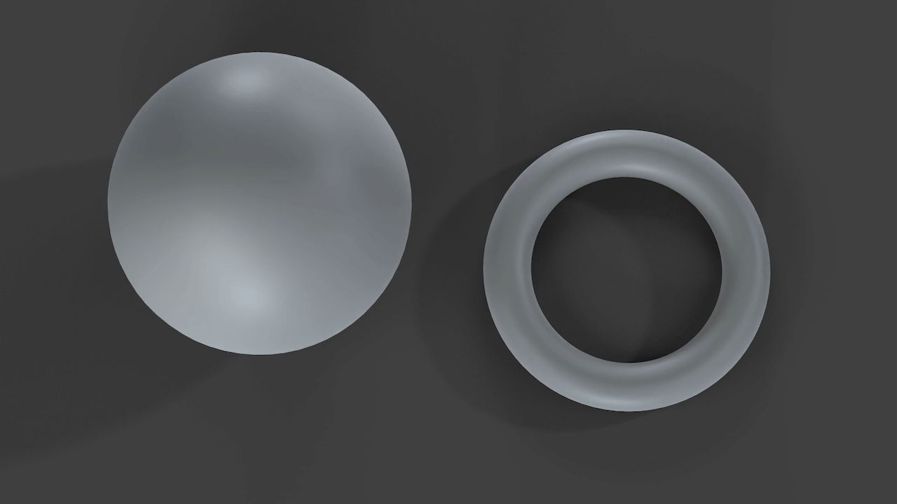
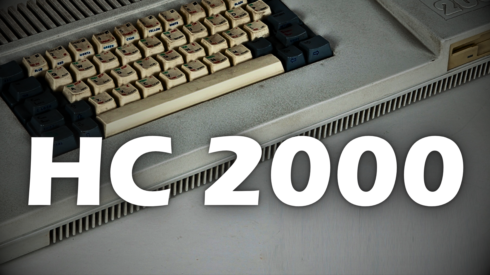

<p align="center"></p>

# Catalin Ilinca

> Engineer by trade. Tryhard creator by night. Slop hater always.

Got questions or doubts? Ping me on Discord: https://discord.gg/XsNcn3kYzn

```
$ whoami
Gamer Dad (gmrdad82)
> engineer            // 20+ years shipping. rust, these days
> builder             // PITO MD: games, a rust engine and the tools around them
> ai stance           // agentic. agents get pages, i get the last word
> youtuber            // Soft Reset: releases, devlogs, gameplay
> based in            // spain (since 2022)
> slop tolerance      // 0.00
```

## PITO MD — the things I build

```
$ ./pito --now
> Splicer      # cuts my videos from their transcripts. freaking fast.
> Manfred      # the recorder. just press 🔴 REC. never lose a take.
> P99          # issue and feedback reports for any website.
> Inbox0       # a roguelite drawn as a mail client. coming to Steam.
> pfx          # the game and render engine under it. rust, gpu, a path tracer.
```

<a href="https://github.com/gmrdad82/pfx"><picture><source media="(prefers-color-scheme: dark)" srcset="assets/pfx-powered-by-128.png"><source media="(prefers-color-scheme: light)" srcset="assets/pfx-powered-by-light-128.png"></picture></a>

Every PITO MD repo has its own agent session. They ask each other for what they need, gate their own work and ship signed releases. I set the direction and say go.

Apps: [Splicer](https://pitomd.com/splicer/) · [Manfred](https://pitomd.com/manfred/) · [P99](https://pitomd.com/p99/) · Engine: [pfx](https://github.com/gmrdad82/pfx)

Open source: [pito-codecs](https://github.com/gmrdad82/pito-codecs) · [pito-compare](https://github.com/gmrdad82/pito-compare) · [prec](https://github.com/gmrdad82/prec) · [pito-tui](https://github.com/gmrdad82/pito-tui) and its crates · [pito-embed](https://github.com/gmrdad82/pito-embed) · [pito-renew](https://github.com/gmrdad82/pito-renew) · [pitomd.com](https://pitomd.com)

[](https://github.com/sponsors/gmrdad82)

## How it started

[](https://youtu.be/LPmitiK-oHI)

▸ [My First Computer — how it all started.](https://youtu.be/LPmitiK-oHI)

## The chapter before

```
$ git log --oneline rails
1afebbe 2006..2026  20+ years of ruby on rails: freelance, lead dev, tech lead, consultant. chapter closed.
```

## Find me

[YouTube](https://www.youtube.com/@S0FTR3S3T) · [X](https://x.com/GamerDady82) · [LinkedIn](https://www.linkedin.com/in/catalinilinca) · [Discord](https://discord.gg/XsNcn3kYzn) · [pitomd.com](https://pitomd.com)

```
$ cat ~/.signature
> if it reads like gpt, i didn't write it.
```
