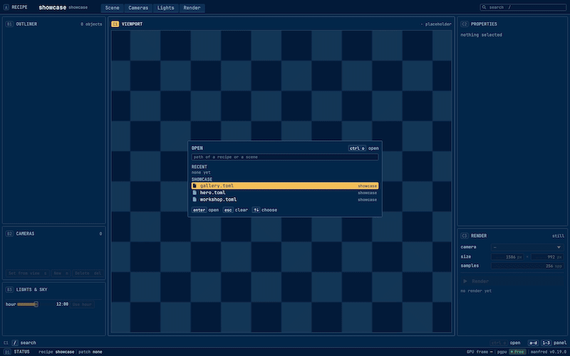

<p align="center"></p>

# Catalin Ilinca

> Engineer by trade. Tryhard creator by night. Slop hater always.

```
$ whoami
Gamer Dad (gmrdad82)
> engineer            // 20+ years shipping. rust, these days
> builder             // PITO: games, a rust engine and the tools around them
> ai stance           // agentic. agents get pages, i get the last word
> youtuber            // Soft Reset: releases, devlogs, gameplay
> based in            // spain (since 2022)
> slop tolerance      // 0.00
```

## PITO — the things I build

```
$ ./pito --now
> Inbox 0      # a roguelite drawn as a mail client. coming to Steam.
> pfx          # the game and render engine under it. rust, gpu, a path tracer.
> Manfred      # the scene tool on top of pfx. TOML recipes in, renders out.
> pito-tui     # the terminal UI every PITO tool runs on.
```

Every PITO repo has its own agent session. They ask each other for what they need, gate their own work and ship signed releases. I set the direction and say go.

Open source: [pfx](https://github.com/gmrdad82/pfx) · [Manfred](https://github.com/gmrdad82/manfred) · [pito-tui](https://github.com/gmrdad82/pito-tui) and its crates · [pitomd.com](https://pitomd.com)

[](https://github.com/sponsors/gmrdad82)

## How it started

[](https://youtu.be/LPmitiK-oHI)

▸ [My First Computer — how it all started.](https://youtu.be/LPmitiK-oHI)

## The chapter before

```
$ git log --oneline rails
1afebbe 2006..2026  20+ years of ruby on rails: freelance, lead dev, tech lead, consultant. chapter closed.
```

## Find me

[YouTube](https://www.youtube.com/@S0FTR3S3T) · [X](https://x.com/GamerDady82) · [LinkedIn](https://www.linkedin.com/in/catalinilinca) · [Discord](https://discord.gg/XsNcn3kYzn) · [pitomd.com](https://pitomd.com)

```
$ cat ~/.signature
> if it reads like gpt, i didn't write it.
```
